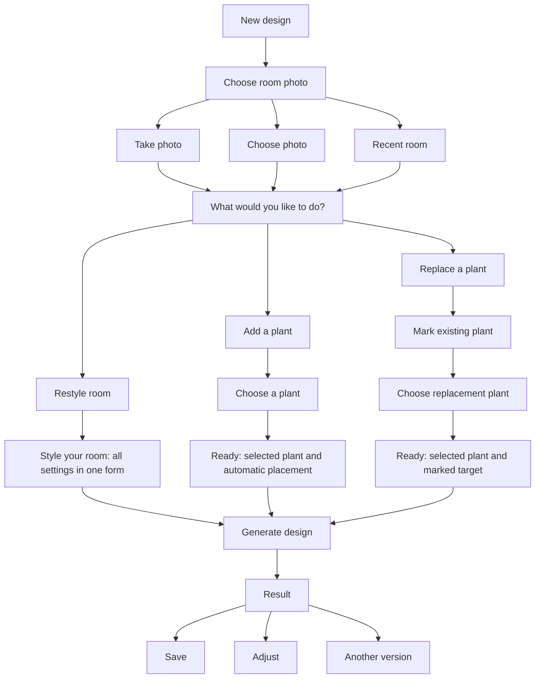
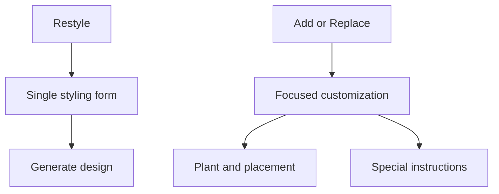

# Image capture and design creation refactor

Date: 2026-09-18
Status: Implementation reference. Restyle now uses the single-screen styling form described below; device validation remains required.
Scope: Planterior mobile app in this repository. The existing server API remains the integration boundary.

## Product decision

Replace the current capture and configuration experience with a focused, photo-first journey:

**Room photo → Restyle / Add / Replace → Generate → Result.**

Proceed directly to production-code implementation in incremental slices. Validate the real implementation as it develops; do not spend a separate phase building a disposable prototype.

There is no Suggested plants feature. The app does not currently have sufficient evidence about room conditions or user preferences to make suitability recommendations. The plant chooser opens Browse directly and offers My plants as its second source.

## Goals and boundaries

- Make a first generated design possible with minimal setup.
- Present no more than three top-level task alternatives at a time. Restyle's styling form is an intentional exception for grouped settings.
- Preserve Restyle, Add, Replace, plant selection, existing styling controls, manual placement, photo reuse, identification, and refinement.
- Use focused views for photo, intent, and placement; keep Restyle settings together in one scrollable styling form.
- Preserve the current theme, shared controls, icons, authentication, subscription behavior, and API integration.
- Keep live AR outside the critical photo-generation path. This plan's placement editor operates on a photograph and must not be described as live AR.
- Do not change pricing, billing policy, server implementation, or cloud sync policy as part of this refactor.

The three-choice limit applies to task alternatives and catalog pages, not Restyle radio groups. Show all available Restyle values without pagination or horizontal overflow. Back, Close, search, and pagination are supporting controls. Native camera, permission dialogs, keyboard, and system photo picker follow platform conventions and are outside this app-owned limit.

Scrolling is acceptable when it is clearly signposted. Scrollable flow screens show a tappable More below label with a downward chevron whenever content remains below the viewport, plus the native scroll indicator. Tapping advances part of a page. Hide the cue at the bottom and restore it when the user scrolls up; recalculate after content or viewport changes. Reserve the cue's space so hiding it does not shift the form or footer. Keep Generate fixed below the scroll area. Allow larger text, small displays, and keyboard use without clipping controls or shrinking text.

## Current problems to remove

Source review identified these behaviors in the current mobile implementation:

- Camera permission states precede the photo-source chooser, even for import users.
- Import requests editing/cropping and then presents another review step.
- PlantSelectionScreen combines mode selection, catalog search, plant size, and expandable styling sections.
- Buttons labeled Preview start image generation.
- Replacement can generate without an explicit target, leaving the intended plant ambiguous.
- State is distributed across screen-local state and navigation parameters.

These are source-level findings, not a completed physical-device UX audit. Recheck the working tree before implementation because these files have active changes.

## Main flow

## Screen specifications

### 1. Choose room photo

Entry: the primary New design action opens this screen directly. Do not route room creation through a competing plant-identification choice.

Choices:

1. Take photo.
2. Choose photo.
3. Recent room, only when usable recent photos exist.

Request camera permission only after Take photo. Denial leaves Choose photo available. Request other permissions only when their feature is used; retain the system picker's platform-supported access behavior.

Capture/import advances directly to the intent screen, where the photo is visible. Remove the app's mandatory standalone photo-review screen. Do not require cropping on import. The photo edit action opens Replace photo or Crop; cancelling either preserves the current photo.

Recent room opens a picker with at most three photos per page. Missing files get a recoverable unavailable state and do not crash or proceed with an invalid URI.

Preserve original aspect ratio and orientation. Prepare a generation asset once per photo revision and reuse it. Do not repeatedly recompress the image as the user moves between screens.

### 2. Choose intent

Title: What would you like to do?

Show the chosen room and three labeled choices:

| Choice | Explanation | Existing API mode |
| --- | --- | --- |
| Restyle room | Create a coordinated arrangement of plants | multi-plant |
| Add a plant | See a particular plant in this room | individual |
| Replace a plant | Swap a plant that is already there | replace-plant |

Selecting an intent advances immediately; no additional Continue action. Remove the persistent mode toggle from configuration pages. Back returns to this choice without losing the photo.

### 3. Restyle styling screen

Open Style your room immediately after selecting Restyle. Show a compact room photo followed by labeled radio groups in this order: Plant type, Style, Plant density, Care level, Pot style, Pot color, Planter boxes. Include optional Special instructions inline at the end. Pot colors have both swatches and names; radio controls expose their selected state to assistive technology.

Keep Generate design and the current allowance in the fixed footer. Remove the Restyle Customize button, group menus, leaf screens, and Done/Apply detours. Selections update the draft immediately without navigating away.

Use the explicit named preset for initial values, visibly selected in the form. Defaults are deterministic product choices, not inferred room suitability. Changing plant type preserves a compatible style when available and otherwise selects a valid style from that type, so generation is never blocked by a cleared style.

Users can change any setting directly or generate with the visible selections. This yields three app decision views before generation: photo source, intent, styling. Native capture/picker interactions are additional. The More below cue makes the remaining settings discoverable without forcing the user to scroll before generating.

### 4. Plant chooser for Add and Replace

Open Browse directly. Offer exactly two sources: Browse and My plants. Do not introduce an intermediate source-selection screen.

- Browse uses the existing catalog with visible text search, current voice-search support, and access to the pet-safe filter.
- Use a stable, understandable ordering such as alphabetical name; do not label catalog entries as recommendations.
- Show at most three selectable plants per page, with result count and explicit pagination.
- Selecting a plant advances to the ready screen with a valid default size.
- Use a named size-selection rule: medium when supported, otherwise the first size in an explicit small/medium/large priority order that the species supports.
- My plants contains user-saved or identified plants, not the entire seeded catalog. Verify the existing persistence distinction before wiring this source.
- Map saved plants into the generation selection through one adapter. Do not fabricate missing botanical properties. If a record lacks required data, offer a matching catalog selection rather than silently inventing it.
- An empty My plants state offers Browse plants or Identify a plant. Identification returns to the preserved design draft after completion or cancellation.
- Empty searches offer editing the query or clearing active filters. Keep the draft intact.

Plant details remain available without making a separate detail screen mandatory. Active filters must be obvious and must not silently exclude the current selection. Treat pet-safe metadata as catalog information, not an AI-generated guarantee.

### 5. Add ready screen

Show the room, selected plant, supported default size, and Automatic placement.

Actions: Generate design, Choose a spot, Customize.

Choose a spot opens the photo placement editor. Confirming placement returns to ready; it never starts generation. Provide a clear way to restore automatic placement.

Do not require placement or size configuration for the common Add path.

### 6. Replace target and ready screen

Before choosing a replacement, show the room with the instruction Mark the plant you want to replace.

Use an adjustable rectangle. A tap can establish an initial box, and handles allow refinement. Retain or adapt existing rectangle-selection behavior where practical. Provide a non-gesture-only accessible adjustment mechanism.

Require a valid target before proceeding. Do not offer automatic target selection in this path. Select the replacement through the shared plant chooser, then show the target and replacement on the ready screen.

Actions: Generate design, Change target, Customize.

Describe the selected size honestly; a photograph does not establish exact physical scale. Preserve the original photograph outside the requested edit as a generation instruction, not as a guaranteed model outcome.

## Optional customization

Restyle has no separate customization hierarchy. All settings are on its styling screen. Add and Replace retain focused customization for plant, size, placement, and instructions.

Expose existing supported combinations only. Restyle uses plant type/style/density; single-plant modes use species/size/placement. Preserve any existing placement-type values through a focused placement-settings view.

Keep all existing selectable values. Restyle groups wrap onto additional rows instead of paginating. Catalog search retains three-result pages. Show the current value and preserve it when returning from another setting.

Before replacing the old screen, record a control-to-destination inventory from the current checkout. Confirm that every existing control has a new location or an explicitly documented reason it is inapplicable. Pet-safe constraints must not be extended to new generation modes without verifying how they are enforced by the available catalog and request contract.

Special instructions are optional. Restyle's inline input updates the draft as the user types, with no separate Apply step. Keyboard and back navigation preserve entered text.

## Generation and result

Generate design is the only submission action on a ready screen. It must be labeled consistently, prevent duplicate taps, and use existing authentication and subscription checks. Display applicable allowance/cost information using the current product policy; this refactor does not introduce a credit scheme.

Persist the draft before submitting. Show truthful phases such as Preparing photo, Uploading, Generating, and Downloading. No invented percentages, minimum display delays, or extra confirmation page.

Show a successful image immediately with before/after comparison and three actions:

| Action | Behavior |
| --- | --- |
| Save | Save once, remain on the result, show saved state |
| Adjust | Open focused editing with existing choices retained |
| Another version | Submit a new intentional generation with the same settings |

Adjust offers Plants, Placement, or Describe a change as applicable. Preserve existing design-refinement behavior and distinguish its source image from creating another independent variation. Another version uses the original request source/settings; refinement uses the selected generated result. Do not silently substitute one for the other.

Keep the previous successful result when generating another version. Store unsaved results as recoverable local drafts; Save promotes a result into the gallery once. Keep draft storage bounded with a documented retention policy and exclude drafts from cloud sync unless the existing policy explicitly supports them.

Failure handling:

- Retain the photo, settings, target, and previous result.
- Offer Retry and Edit setup when appropriate.
- Distinguish interrupted/unknown requests from explicit failures. Do not promise free retries or start a second paid request merely because a network response was lost.
- Reuse the existing job/recovery contract where available. Any unsupported server recovery requirement is a separate dependency, not an assumed capability.
- Returning from sign-in or the paywall restores ready state and requires an explicit Generate tap.
- Do not describe closing the progress screen as server cancellation unless cancellation is confirmed by the API.

## Mobile architecture

Introduce one typed design-flow draft owned above the flow's screens. Use the existing state-management approach rather than adding a state library solely for this change.

Draft data should include:

- Stable draft ID, owner/account scope, schema version, timestamps.
- Original photo URI, prepared photo URI, dimensions/orientation, photo revision.
- Intent and valid per-mode configuration.
- Selected plant identity and supported size/placement.
- Normalized target rectangle tied to the photo revision.
- Special instructions and customization state.
- Request identity, job identity/status when available, and recoverable result references.

Keep UI intent separate from API mode names. A single validated adapter produces GenerationRequest at submission. Reject impossible combinations before network work: missing photo, missing plant, unsupported size, or Replace without a target.

Suggested app-owned states: photo, intent, plant, target, ready, customization, generating, result, and recoverable-error. Navigation back behavior must be explicit for each branch.

State rules:

- Back preserves draft data.
- Changing the photo invalidates prepared assets and all placement coordinates; retain other compatible choices.
- Cropping changes the photo revision and invalidates the target unless a tested coordinate transform updates it correctly.
- Mode changes retain compatible preferences but do not submit stale fields from another mode.
- Target coordinates derive from the displayed image rectangle, excluding letterboxing, and normalize to the submitted image.
- Account changes isolate drafts and pending results appropriately.
- App restart restores usable local draft state; request resumption depends on actual server capabilities.

Use a shared screen shell for heading, photo context, safe areas, Back/Close, and fixed action area. Reuse the current design system and icon library. Keep expensive image work and API submission out of render effects that can repeat during navigation.

Primary integration points:

- src/navigation/screenWrappers.tsx: entry points, flow routes, shared draft ownership.
- src/screens/CameraScreen.tsx: permission timing, capture/import, optional crop.
- src/screens/PlantSelectionScreen.tsx: replace combined configuration with focused views.
- src/components/IndividualPlantSelector.tsx: reusable catalog selection, search, pagination.
- src/screens/PlantLocationScreen.tsx: mode-specific target rules and coordinate correctness.
- src/screens/GenerationScreen.tsx: submission, recoverable results, explicit action labels.
- src/types/index.ts: typed flow draft and adapters as needed.
- Existing local persistence and aiApiService: reuse; extend narrowly where draft/recovery work requires it.

Do not edit the web repository as part of mobile implementation. Document any verified API gap separately.

## Entry points and feature preservation

| Entry | Flow behavior |
| --- | --- |
| New design | Choose room photo |
| Reuse existing room | Prefill photo, open intent |
| Add this plant from plant detail | Prefill Add and plant, choose photo, then ready |
| Refine saved design | Prefill source result and existing choices, open focused adjustment |
| Identify plant in Library | Keep identification independent; offer using a saved plant afterward |
| Resume draft | Restore last valid step and preserved data |

Avoid re-asking a question whose answer is already supplied by the entry point.

## Implementation sequence: no prototype gate

### Phase 1: Flow foundation and Restyle

1. Inspect current edits and inventory existing controls/entry points.
2. Add typed draft state, request adapter, and shared screen shell.
3. Implement photo source and intent screens.
4. Move permission requests to the relevant action; remove mandatory crop/review.
5. Implement the single-screen Restyle styling form with visible selected values, fixed Generate action, and overflow cue.
6. Connect the existing generation API and result path.

Completion: an authenticated user can create and save a Restyle through the new flow without configuring optional settings.

### Phase 2: Add and Replace

1. Refactor the plant chooser into Browse/My plants with three-result pages.
2. Retain search, voice search, pet-safe filtering, and supported plant sizes.
3. Implement Add with automatic placement and optional manual placement.
4. Implement Replace with required target selection.
5. Connect prefilled entry points from plant and design details.

Completion: all three modes use the new flow and preserve the existing API mode contract.

### Phase 3: Customization and recovery

1. Complete the option inventory and focused editors.
2. Persist draft and result state; implement idempotent local Save behavior.
3. Connect Adjust and Another version with explicit source-image semantics.
4. Handle permissions, missing photos, authentication, paywall return, interruptions, and account changes.
5. Remove obsolete screens/routes only after all callers are migrated.

Completion: all retained options are reachable, and normal navigation or recoverable failures do not discard work.

### Phase 4: Validate the implemented app

Perform focused checks throughout implementation, then complete device validation across the full journey. Do not defer all testing until the entire refactor is finished.

Automated checks should cover meaningful behavior:

- Mode-to-request mapping and Replace target requirement.
- Defaults restricted to supported plant values.
- Photo revision/coordinate invalidation and letterbox conversion.
- Back, mode changes, and prefilled entry points preserving valid state.
- Duplicate submission and duplicate Save prevention.
- Draft recovery and user isolation.

Run the project's appropriate typecheck and affected tests. Do not start Expo/EAS/native builds unless explicitly requested.

On Android and iOS, verify capture, import, denied permissions, optional crop, recent images, keyboard behavior, larger text, placement gestures, background/foreground, network interruption, sign-in/paywall return, saving, and all three generation modes. Clearly distinguish simulated tests from authenticated API and physical-device results.

## Acceptance criteria and measurement

- Top-level decisions display at most three alternatives; catalogs display at most three selectable results per page. Restyle shows all styling values in labeled radio groups.
- Restyle requires no Customize, category, or setting navigation; all settings are directly editable on one screen.
- Scrollable flow screens display More below only while content remains beneath the viewport. The cue responds to scrolling, layout changes, and content changes, and is tappable.
- Restyle requires no optional configuration and uses at most three app decision views before generation, excluding native photo acquisition.
- Add does not require manual placement; Replace requires an explicit target.
- No generation action is labeled Preview.
- No required crop or standalone app photo-review step.
- Camera denial never blocks photo import.
- Every previously supported option has a verified destination.
- No photo, valid configuration, or successful result is lost through ordinary Back navigation or recoverable errors.
- Save does not create duplicates on repeated taps.
- Accessible text and controls remain reachable on small screens and with the keyboard open.

Instrument the existing analytics system, if available, with photo-selected, intent-selected, plant-selected, target-confirmed, generate-requested, result-visible, result-saved, and flow-exited events. Include mode, step, entry point, and elapsed time; do not log images, free-text prompts, or credentials.

Measure setup duration separately from upload and model generation. Proposed initial usability targets are 80% unassisted task completion and median default Restyle setup below 30 seconds after photo selection. These are targets to evaluate on the working app, not existing measured outcomes or implementation blockers.

## Reference principles

- [NN/g: Progressive Disclosure](https://www.nngroup.com/articles/progressive-disclosure/): make secondary configuration available on demand.
- [Apple: Onboarding](https://developer.apple.com/design/human-interface-guidelines/onboarding): help people learn while doing, with contextual guidance.

The agreed direction takes priority: implement the new mobile flow directly, retain the app's capabilities, and validate the real experience as each slice becomes usable.
